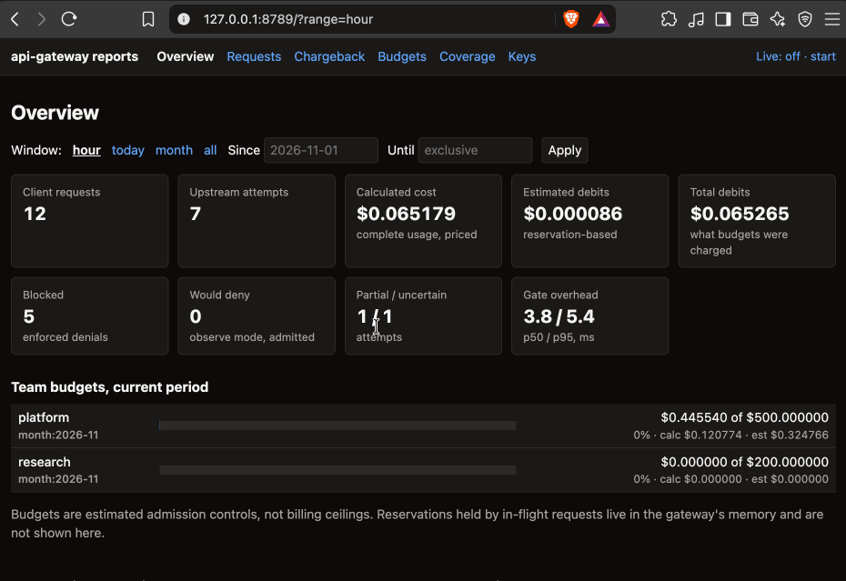

# api-gateway

A lightweight AI gateway for LLM traffic: the reference implementation for
[API gates: controlling AI consumption in the enterprise](https://www.vgtc.io/insights/enterprise-ai-gateway).

> **Disclaimer: demo only.** This repository exists to support and substantiate the claims
> made in the article above. It is not intended for production use and comes with no
> support or stability guarantees. Use it to read, run and experiment with, not to put
> in front of real traffic.

One control point that:

- attributes every routed call to an owner, team, app and environment through virtual keys;
- enforces model allowlists, request-per-minute limits and total-token admission limits;
- applies **estimated reserve-then-settle** budget admission per key and per team, shared
  across providers, and records overruns instead of hiding them;
- relays the Anthropic Messages API **byte for byte**, streaming and non-streaming, so coding
  agents such as Claude Code keep working (`ANTHROPIC_BASE_URL`);
- meters tokens (input, output, cache read, 5-minute and 1-hour cache writes) from responses
  and keeps calculated costs separate from estimated debits;
- logs metadata only, never prompts or responses.

Budgets and TPM limits are **admission controls based on estimates**, not hard billing or
generation ceilings, and not replicas of provider rate limits.

## Quickstart (Docker)

```bash
cp config.example.yaml config.yaml
cp .env.example .env
# Put provider credentials in .env. Replace every REQUIRED rate in config.yaml with a
# verified price and note the pricing-page link and the date you checked it.
docker compose build
docker compose run --rm --no-deps api-gateway check-config   # placeholders must fail
docker compose up -d
docker compose exec api-gateway api-gateway keys create --owner alice --team platform \
  --app demo --env dev --models claude-sonnet-5-5,deepseek-flash --budget 0.50
ANTHROPIC_BASE_URL=http://localhost:8787 ANTHROPIC_API_KEY=gk_... claude
docker compose exec api-gateway api-gateway report --by model
open http://localhost:8789                                     # read-only report UI
```

The gate listens on `127.0.0.1:8787` and the report UI on `127.0.0.1:8789`, both on loopback
only. If a port is taken, set `API_GATEWAY_HOST_PORT` or `API_GATEWAY_UI_HOST_PORT` in `.env`.
Run one replica: rate windows and reservations live in process memory.

## Demo: OpenCode through the gate

The recording below shows [OpenCode](https://opencode.ai/) calling Claude Sonnet 5.5 and
DeepSeek Flash through the local gateway. Switch models in OpenCode, send a request, then
check the report UI: both providers appear in the same view, with token usage, calculated
costs, estimated debits and team budget totals.



To try it after the Docker quickstart:

1. Give OpenCode the virtual gateway key (`gk_...`) created above. Provider credentials
   stay in the gateway's `.env`.
2. Configure OpenCode's [custom providers](https://opencode.ai/docs/providers/#custom) to
   send **Anthropic-format** requests to the gateway's Messages endpoint,
   `http://localhost:8787/v1/messages`. Use the Anthropic-compatible format for both
   providers, with model IDs `claude-sonnet-5-5` and `deepseek-flash`, matching `config.yaml`
   and the key's allowlist. Adjust the host port if you changed it in `.env`.
3. Select each model in OpenCode and send a small synthetic prompt, such as
   "Describe a lighthouse in three words."
4. Open [the requests feed](http://localhost:8789/requests?refresh=5) to follow the calls,
   then check **Overview** or **Chargeback** to compare providers and see their shared
   budget accounting. Adjust the UI port if needed.

The UI shows committed data after requests settle. Calculated costs and estimated debits
remain separate; the budget is an estimated admission control.

## Report UI

`docker compose up` also starts `api-gateway-ui`: a read-only browser view of the same
reports the CLI prints, for demos. It has an overview (spend by provider, team and model,
team budgets, blocked and would-deny counts, gate overhead), a live requests feed with
per-request detail, chargeback, budgets, coverage, and the key list. Add `?refresh=5` to any
page, or click "Live", to reload it every five seconds while you send traffic.

Every number comes from `gate/app/reports.py`, and each table offers CSV and JSON downloads
identical to the CLI's `--format csv|json` output. The UI runs in its own process with a
read-only SQLite connection and no provider keys, and it cannot create or revoke keys; use the
CLI for that. It has **no login**: keep it on loopback and never publish it on a network
interface. It shows committed data only, so reservations held by in-flight requests appear
once those requests settle.

## Claims

| Article claim | Feature | Code |
| --- | --- | --- |
| One control point attributes and limits calls | Virtual keys, allowlists, RPM/TPM, budgets | `gate/app/lifecycle.py`, `gate/app/admission.py` |
| The hard parts are streaming, metering and budgets under concurrency | Yield-then-parse relay, atomic admission lock, per-attempt settlement | `gate/app/relay.py`, `gate/domain/ledger.py`, `gate/domain/accounting.py` |
| A gate can inspect without modifying | Byte-for-byte relay, flag-only detection by default | `gate/providers/anthropic.py`, `gate/domain/detection.py` |
| Roll out by observing first | Per-policy `observe`/`enforce` modes with would-deny reporting | `gate/domain/policy.py` |
| Overhead is measurable | `gate_overhead_ms` per request; overhead benchmark against a mock upstream | `bench/overhead.py`, `bench/mock_upstream.py` |

## Layout

```text
gate/domain/     pure rules: money, pricing, periods, rate windows, ledger, accounting, detection
gate/providers/  Anthropic-format adapter: headers, errors, SSE usage parser, completeness
gate/app/        use cases and ports: lifecycle, admission, routing, relay, keys, reports
gate/adapters/   FastAPI, httpx, SQLite, JSONL log, YAML config, CLI, report UI
gate/main.py     composition root
bench/           mock upstream, overhead benchmark, multi-provider demo
```

Dependencies point inward only, enforced by import-linter. Domain and provider code does no
I/O and never reads a clock, so every rule is testable without a network or database.

## CLI

```text
api-gateway keys create --owner O --team T --app A --env dev|staging|prod --models m1,m2 \
                        [--budget USD] [--period day|month] [--tpm N] [--rpm N]
api-gateway keys list [--team T] [--include-revoked] [--format table|csv|json]
api-gateway keys revoke <key_id|prefix>
api-gateway report --by team|app|owner|model|key|deployment|provider|all [--since D] [--until D]
api-gateway report budgets --by key|team --period month:2026-11
api-gateway report coverage
api-gateway report requests [--limit N] [--team T] [--app A] [--key PREFIX] [--model M] \
                            [--provider P] [--status ok|blocked|error|open|interrupted]
api-gateway report request <request_id>
api-gateway check-config
api-gateway serve
api-gateway ui                       # read-only report UI
```

Every `report` command takes `--format table|csv|json`. There is no admin HTTP API: the CLI
writes to the same SQLite file, and key changes take effect on the next request.

## Development

```bash
uv sync
uv run pytest
uv run ruff check . && uv run ruff format --check .
uv run mypy --strict gate
uv run lint-imports
```

Run the mock upstream with `uv run python -m bench.mock_upstream --port 9999`, and try both
providers with `GATE_KEY=gk_... uv run --with anthropic python -m bench.demo_multiprovider`.

## Known limits

Single replica; no SSO or SCIM; no web admin UI (the report UI is read-only and has no login); no format translation between providers; estimated
admission controls rather than billing ceilings; unsettled attempt costs are lost if the
process crashes; provider feature support differs between Anthropic and DeepSeek. The
documented non-billable rejection rules in `gate/providers/anthropic.py` must be verified
against provider documentation before cost-reconciliation results are published.

## Licence and contributions

MIT, see [LICENSE](LICENSE). The licence covers this repository's code, not the contents of
a built Docker image. Issues are welcome. Pull requests may not be reviewed quickly, because
the repository's job is to stay readable and match the article.
